# layercraft

**A compiler from a solid to a print, with the hood off.** layercraft takes a 3MF and compiles it
all the way down to the file a Bambu Lab X2D prints, through five stages you can each open, read,
change and compile on from.

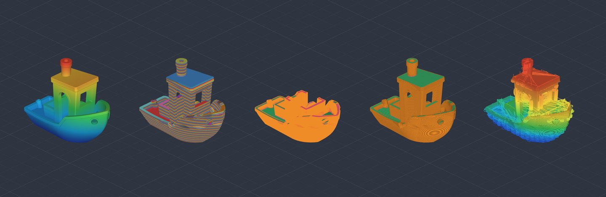

Slicers are usually closed boxes: a mesh goes in, G-code comes out, and what happens in between
can only be nudged through settings. layercraft writes every step down. It was built for AI
agents, who work best when every intermediate result is a file they can inspect, and it turns out
curious humans like that too.

## What sets it apart

Every picture here is a screenshot of [SolidCraft](#look-at-any-stage) showing the `.ply` files
layercraft wrote: nothing is drawn for the occasion.

<table>
<tr>
<th width="50%">What it does</th>
<th width="50%">What it looks like</th>
</tr>

<tr>
<td>

**Every stage is a file.** Stop at any stage, read it, change it, and compile on from there.
Nothing reaches around the chain, so what you read is what the next stage gets.

```bash
layercraft compile part.3mf --out part.gcode.3mf \
  --emit paths=paths.json          # stop and look
layercraft compile --from paths=paths.json \
  --out part.gcode.3mf             # carry on
```

The stages of one layer sit on top of each other, a bent layer's on its bend. This one boat is four files, from the
bottom up: the program coloured by time, then the paths, the regions and the sections.

</td>
<td>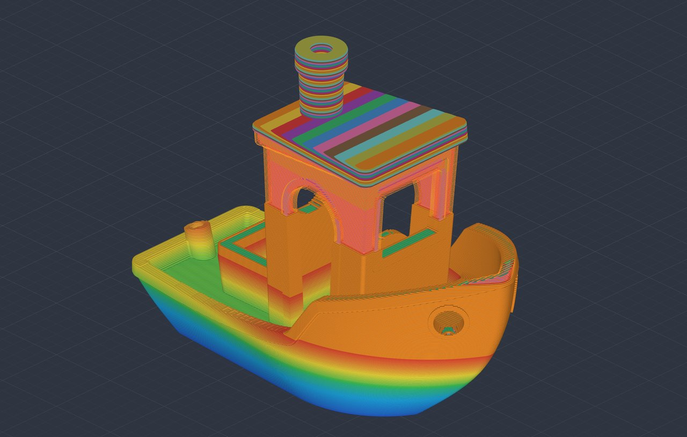</td>
</tr>

<tr>
<td>

**Layers bend to the surface.** Under a top sloped up to 20°, the layers bend to follow it, so
the top is one continuous skin and not a staircase. They bend only as far as the nozzle's
measured shape lets them, and each bead pushes only the plastic the nozzle's face leaves it.

The same wave twice, a colour per layer. In front, compiled with `--flat`: the layers end in
steps across the top. Behind: one layer, whole.

</td>
<td>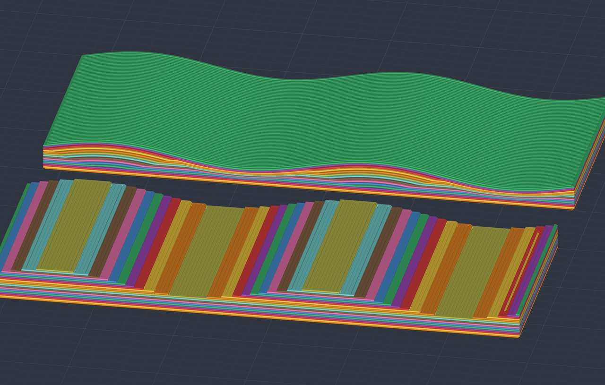</td>
</tr>

<tr>
<td>

**The plate has no direction.** Every algorithm is equivariant under the plate's isometries,
E(2): a part turned, moved or mirrored is printed turned, moved or mirrored, and nothing else
changes. A direction comes from the part's walls, strips and slopes, never from the plate's axes
or a grid laid on them. Only the machine may break that symmetry, where its hardware does.

Six copies of one shape with `--infill rolls`, each turned or mirrored by its own amount, cut
through the same layer: each carries the same lines.

</td>
<td>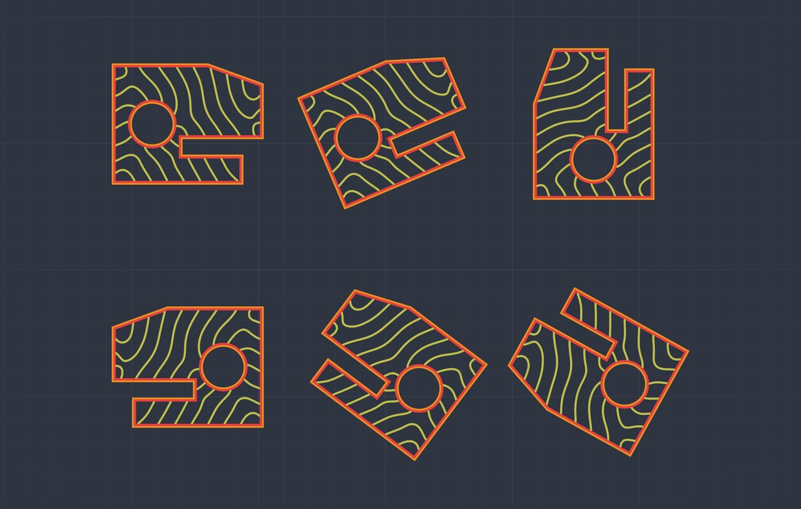</td>
</tr>

<tr>
<td>

**Every millimetre of filament comes from geometry.** Squeezed between the nozzle and the layer
below, a bead of width *w* and height *h* takes the shape of a stadium, a rectangle with a
half-disc on each side. Its cross-section, and how far apart beads go so that they tile a surface
with neither gaps nor overlaps, follow from that shape alone:

`A = (w − h)·h + π·h²/4`<br>
`s = w − h·(1 − π/4)`

layercraft pushes exactly the filament that fills that volume, bead by bead. SolidCraft draws
each bead as that very stadium.

</td>
<td>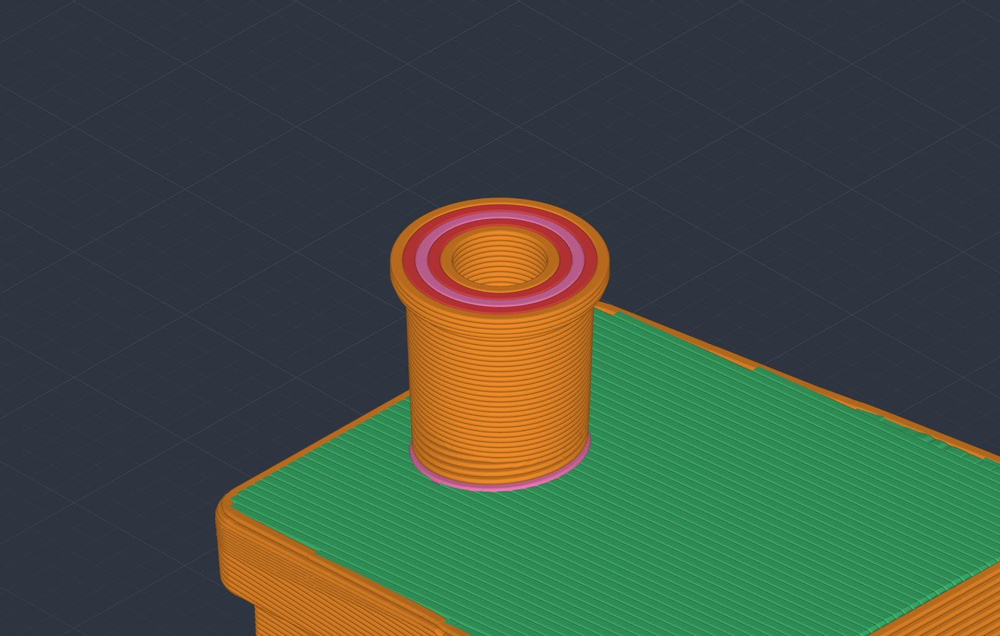</td>
</tr>

<tr>
<td>

**A bead as wide as its strip.** What the walls leave, and any strip too thin for two lines,
takes one bead along its chordal axis, its width following the strip.

A crescent thinning towards its horn, coloured by bead width: two walls of constant width, and
between them one bead widening and narrowing along its length.

</td>
<td>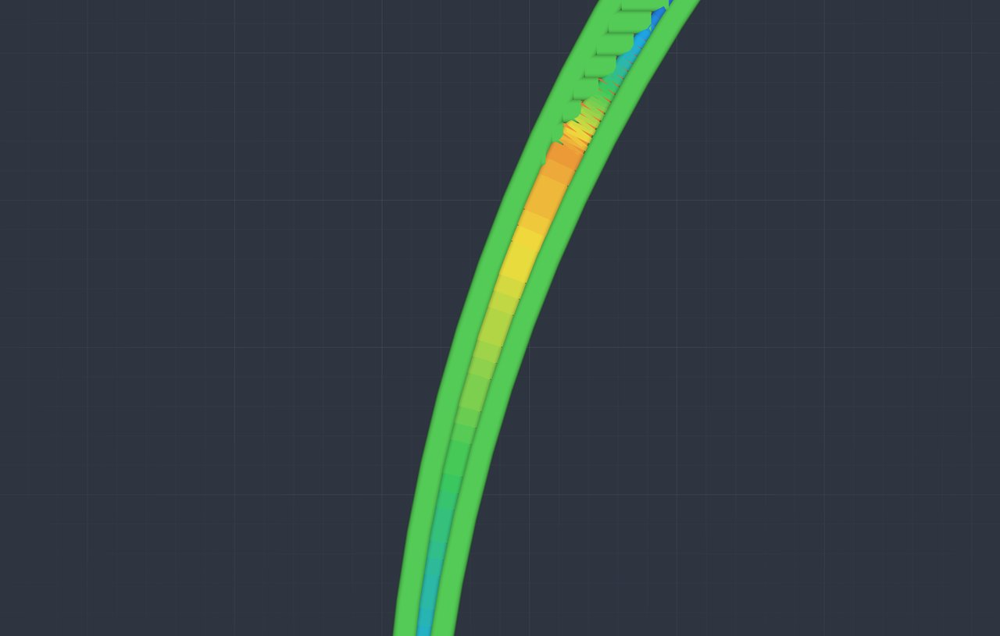</td>
</tr>

<tr>
<td>

**Infill that grows like convection rolls.** With `--infill rolls`, sparse infill is the zero
set of a Swift–Hohenberg field relaxed over each layer's sparse area. Its lines run wall to wall,
one line spacing apart. Each layer's field starts from the one below, so its lines rest on those
below, and every five layers they lean the other way.

Only the infill of a block is shown here, a colour per layer: the rolls stand in stacked walls.

</td>
<td>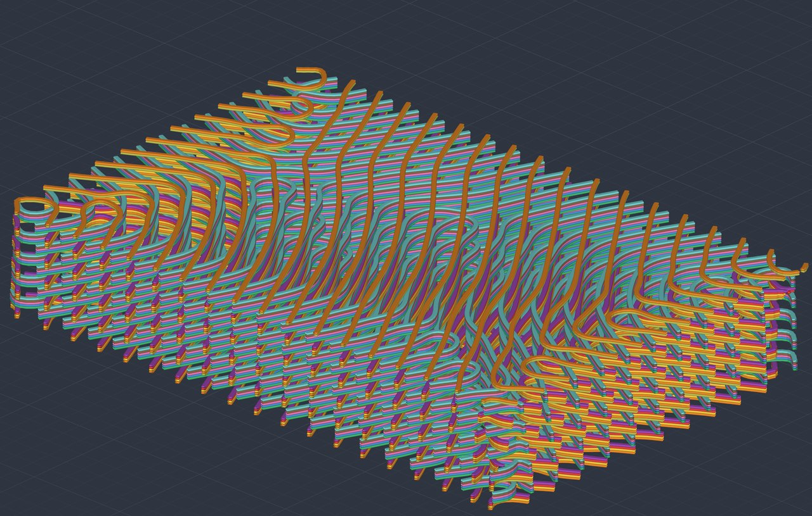</td>
</tr>

<tr>
<td>

**Bridges cross the short way, supports stand straight.** Strands cross a bridge the short way
over the air, anchored on both sides. What a strand cannot bridge stands on columns with
`--supports on`, under a roof of hanging strands, with a gap of air so that they come off.

On the left, an arch at its first layer over the span, strands in brown. On the right, a T whose
bar stands on columns.

</td>
<td>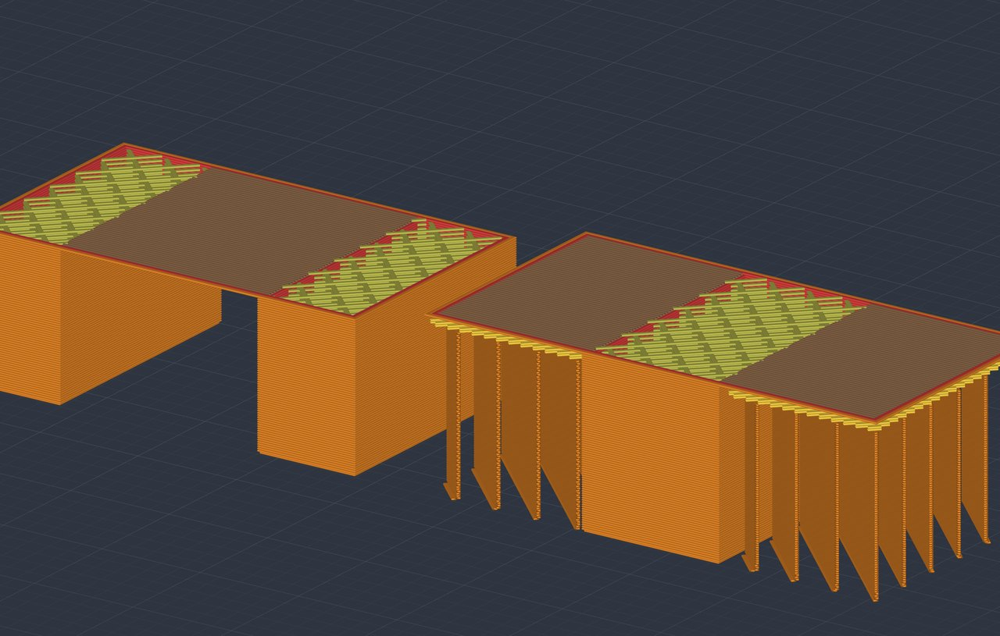</td>
</tr>

<tr>
<td>

**Speed follows what the bead rests on.** A look-ahead planner gives every move its speed and
time. A wall slows by the share of its bead that hangs over air, every bead is held to what the
hot end melts, and a layer that would print faster than it cools slows down, then waits off the
part.

The Benchy's moves coloured by speed: the hull leaning out over the plate at 50 mm/s, in blue,
like the edges above its windows; the walls above at 200 mm/s.

</td>
<td>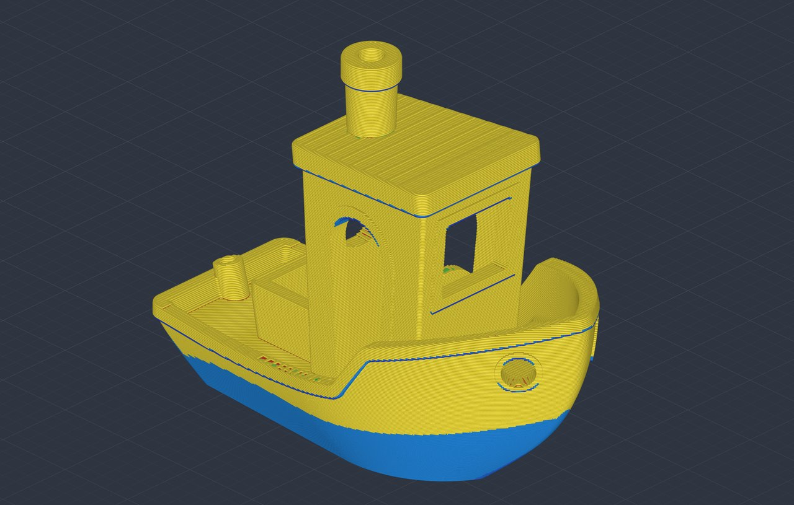</td>
</tr>

<tr>
<td>

**The nozzle leaves on a helix.** A straight lift pulls a string up with it; a helix breaks it.
Its 1.2 mm radius is the smallest that broke the string on the printer. Each layer's beads are
ordered by the tour that retracts least, then travels least, and a travel that would cross a bead
at its own height lifts over it.

The Benchy, in grey, cut at the cabin's windows, with only the moves that lay nothing: travels in
yellow, lifts in purple.

</td>
<td>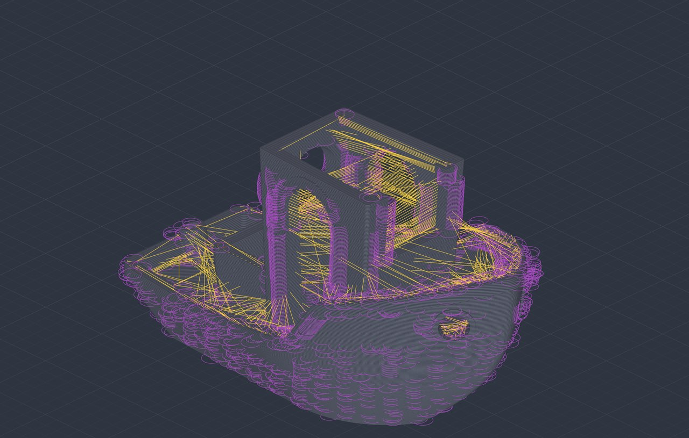</td>
</tr>

<tr>
<td>

**Any setting can vary by place.** `--tune` takes boxes of the build volume, each with the
settings it changes, for any stage, so several variants of a test share one plate. The plates
in [`calibration/`](calibration/) are made this way.

```json
[{"within": {"z": [6, 12]},
  "set": {"motion": {"outer_wall": {"speed": 60}}}}]
```

A cylinder printing faster every 6 mm, coloured by speed.

</td>
<td>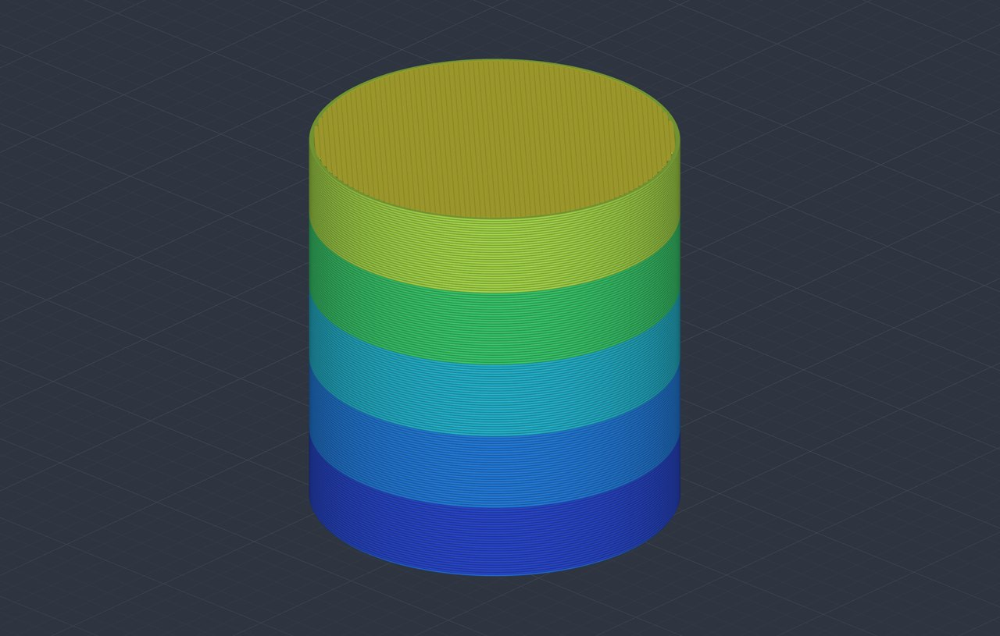</td>
</tr>

<tr>
<td>

**Every number is there to look at.** Each element of a `.ply` file carries its numbers: colour
by any of them, filter by ranges of them. `layer ≤ k` peels the print, `t ≤ t₀` replays it.

The card lists the roles by name, since the file's header names them, and draws how the print's
beads spread over time. This is the Benchy, 1400 s into its 2021 s.

</td>
<td>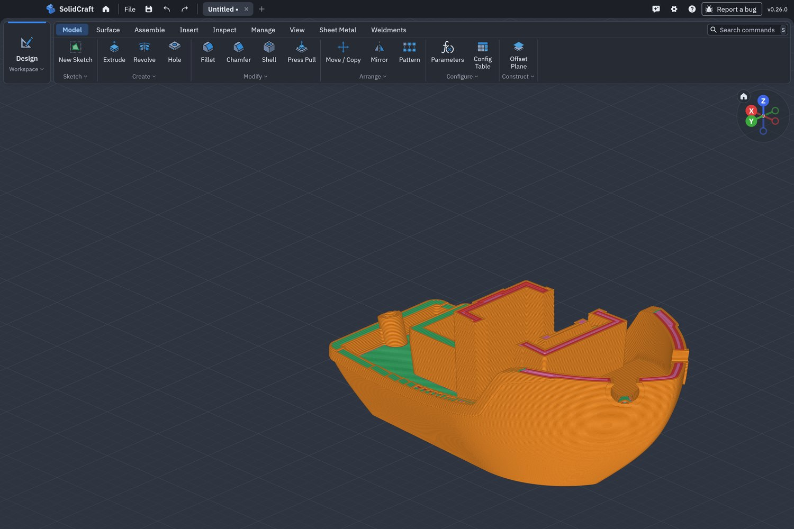</td>
</tr>
</table>

## How a solid becomes a print

| Stage | What it holds | How it is made |
|---|---|---|
| **mesh** | the solid's triangles, standing on the plate | read from the 3MF, every index and number checked |
| **sections** | one planar region per layer | the *exact* cut of the mesh at the layer's mid-height: a vertex on the plane counts as above it, so every cut edge is cut once and the loops close with no tolerance |
| **regions** | each layer split into walls, top and bottom skins, solid and sparse infill, bridges, and the supports under what nothing holds up | Boolean operations and offsets on a nanometre lattice, exact in integers |
| **paths** | every bead, in printing order | wall loops with their seams lined up, dense insets and lines along the part's own directions, strands across bridges |
| **program** | every move of the nozzle, layer by layer, each with all it does: where it goes (a line, or an arc climbing about a vertical axis), the filament, speed, acceleration and fan, and the bead it lays | filament from the volume each bead fills, speeds from the machine, time from a look-ahead planner |

Then the machine's own G-code is put around the layers, `verify` checks every move against the
machine, and the program is written as G-code and packed into the `.gcode.3mf` the printer reads
from its storage. A program can also be read back from any slicer's G-code, and several programs
merged onto one plate.

## Look at any stage

Write a stage to a `.ply` file and it becomes a picture: points, segments and triangles, each
carrying named numbers.

```bash
layercraft compile part.3mf --out part.gcode.3mf \
  --emit paths=paths.ply --emit program=program.ply
```

| Stage | Drawn as | Its numbers |
|---|---|---|
| mesh | triangles | `body` |
| sections | the section, triangulated | `layer` |
| regions | wall centre lines and filled areas | `layer`, `role` |
| paths | beads | `layer`, `role`, `width`, `height`, `bead` (printing order) |
| program | moves | per point: `t` (seconds); per move: `layer`, `move`, `role`, `width`, `height`, `speed`, `e`, `fan` |

A segment with a `width` and a `height` is a bead of that cross-section. A role has the same
number in every stage, and the file's header names them (`role: 0 outer wall, 1 overhang wall, …`),
so a viewer can show a legend.

[SolidCraft](https://github.com/tangency-labs/solidcraft) draws all of this, live, with the
colour and the filters on the GPU, so a slider follows the mouse even on the 2 million moves of
a Benchy's program. This came after its `v0.40.0-rc.2`: until a later release, build its `main`.

## Never harm the machine

A wrong line of G-code can drive the nozzle into the bed. So no program leaves layercraft
without passing `verify`: every position inside the build volume, the head never coming down
into what is printed, each bead on its layer's top, speeds and flow within what the machine and
the hot end allow, every number finite. A program that fails is an error, never a warning. What
the machine description does not tell of a printer, such as its nozzle's shape, is measured on
the printer and kept in its folder of [`printers/`](printers/).

And layercraft writes files. It never starts a print: that takes a person, every time.

## Use

```bash
cargo install --path apps/layercraft
layercraft machine import                       # once: the X2D, 0.20 mm Standard, Bambu PLA Basic
layercraft compile part.3mf --out part.gcode.3mf
layercraft compile part.3mf --out part.gcode.3mf --tune tune.json   # vary settings by place
layercraft merge a.json b.gcode.3mf --out plate.gcode.3mf   # several programs on one plate
layercraft compare part.gcode.3mf other.gcode   # side by side with another slicer's output
```

`machine import` reads the printer maker's profiles from an installed Bambu Studio, once, into
`~/.config/layercraft/`; nothing from them enters this repository. `compare` lines up two
G-code files layer by layer and feature by feature: another slicer is a reference to compare
against, not an oracle. `merge` prints programs together, layer by layer: program stages and
G-code from any slicer, each already placed, so two slicers' parts can share one plate. Each
colour a 3MF gives its objects is a material, printed in its own pass per layer with the X2D's
filament change between.

## What it does not do yet

One printer, the Bambu Lab X2D. Supports are straight columns of lines, with no tree supports and
no interface under a column standing on the part. layercraft is young: every change is checked
against solids whose volumes and sections are known exactly.

## The rest

- [SOUL.md](SOUL.md): what layercraft is for.
- [AGENTS.md](AGENTS.md): how to work on it, for agents and people.
- [CHANGELOG.md](CHANGELOG.md): what changed.

MIT OR Apache-2.0, written from public specifications and mathematics. The boat is the
[3DBenchy](https://en.wikipedia.org/wiki/3DBenchy) by Creative Tools, in the public domain; the
other parts are generated in code.
