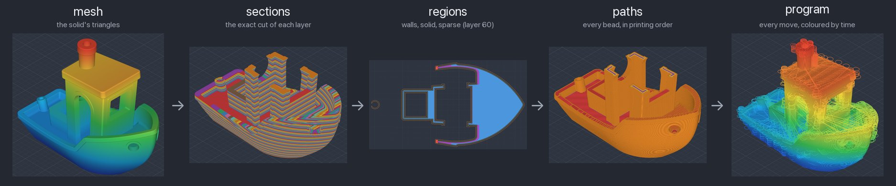
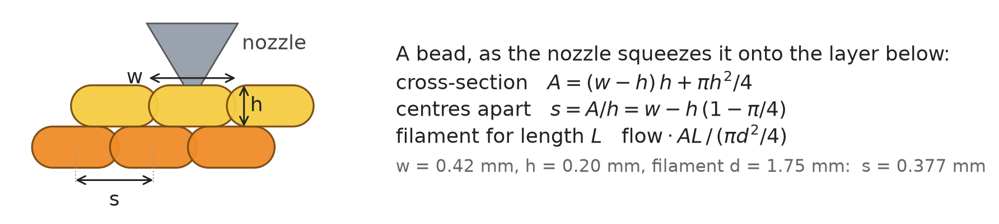
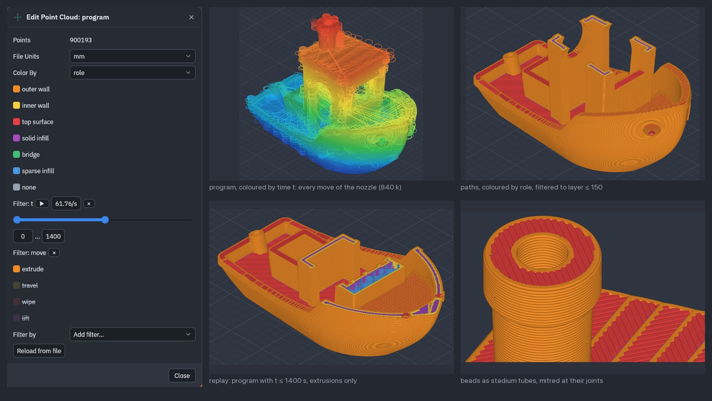

# layercraft

**A compiler from a solid to a print, with the hood off.** layercraft takes a 3MF and compiles it
all the way down to the file a Bambu Lab X2D prints, through five stages you can each open, read,
change and compile on from.



Slicers are usually closed boxes: a mesh goes in, G-code comes out, and what happens in between
can only be nudged through settings. layercraft writes every step down. It was built for AI
agents, who work best when every intermediate result is a file they can inspect, and it turns out
curious humans like that too.

## How a solid becomes a print

| Stage | What it holds | How it is made |
|---|---|---|
| **mesh** | the solid's triangles, standing on the plate | read from the 3MF, every index and number checked |
| **sections** | one planar region per layer | the *exact* cut of the mesh at the layer's mid-height: a vertex on the plane counts as above it, so every cut edge is cut once and the loops close with no tolerance |
| **regions** | each layer split into walls, top and bottom skins, solid and sparse infill, bridges | Boolean operations and offsets on a nanometre lattice, exact in integers |
| **paths** | every bead, in printing order | wall loops with their seams lined up, hatches on a fixed grid, strands across bridges |
| **program** | every move of the nozzle, with its time | filament from the volume each bead fills, speeds from the machine, time from a look-ahead planner |

Then `verify` checks every move against the machine, and the program is written as G-code and
packed into the `.gcode.3mf` the printer reads from its storage.

Any stage can be written out and read back in:

```bash
layercraft compile part.3mf --out part.gcode.3mf --emit paths=paths.json   # stop and look
layercraft compile --from paths=paths.json --out part.gcode.3mf            # carry on from there
```

## Every millimetre of filament, from geometry

Squeezed between the nozzle and the layer below, a bead takes the shape of a *stadium*: a
rectangle with a half-disc on each side. Its cross-section, and how far apart beads go so that
they tile a surface with neither gaps nor overlaps, follow from that shape alone:



layercraft pushes exactly the filament that fills that volume, bead by bead: a layer's plastic
is the sum, over its beads, of cross-section times length. Each bead's centre sits half its
height under the nozzle, at the layer's mid-height where the section is cut, which is why the
stages of one layer sit exactly on top of each other when you look at them together.

## Look at any stage

Write a stage to a `.ply` file and it becomes a picture: points, segments and triangles, each
carrying named numbers.

```bash
layercraft compile part.3mf --out part.gcode.3mf \
  --emit paths=paths.ply --emit program=program.ply
```

| Stage | Drawn as | Its numbers |
|---|---|---|
| mesh | triangles | `body` |
| sections | the section, triangulated | `layer` |
| regions | wall centre lines and filled areas | `layer`, `role` |
| paths | beads | `layer`, `role`, `width`, `height`, `bead` (printing order) |
| program | moves | per point: `t` (seconds); per move: `layer`, `move`, `role`, `width`, `height`, `speed`, `e`, `fan` |

A segment with a `width` and a `height` is a bead of that cross-section. A role has the same
number in every stage, and the file's header names them (`role: 0 outer wall, 1 inner wall, …`),
so a viewer can show a legend. Colour by any number, filter by ranges of them: `layer ≤ k`
peels the print layer by layer, `t ≤ t₀` replays it.

[SolidCraft](https://github.com/tangency-labs/solidcraft) draws all of this, live, with the
colour and the filters on the GPU, so a slider follows the mouse even on the 840 000 segments of a
Benchy's program. This is still a proposal upstream; until it lands, it lives on the
[`stage-viewer` branch of a fork](https://github.com/mariogeiger/solidcraft/tree/stage-viewer).



## Never harm the machine

A wrong line of G-code can drive the nozzle into the bed. So no program leaves layercraft
without passing `verify`: every position inside the build volume, the nozzle never below the
layer it prints, speeds and flow within what the machine and the hot end allow, every number
finite. A program that fails is an error, never a warning.

And layercraft writes files. It never starts a print: that takes a person, every time.

## Use

```bash
cargo install --path apps/layercraft
layercraft machine import                       # once: the X2D, 0.20 mm Standard, Bambu PLA Basic
layercraft compile part.3mf --out part.gcode.3mf
layercraft compile part.3mf --out part.gcode.3mf --tune tune.json   # vary settings by place
layercraft compare part.gcode.3mf other.gcode   # side by side with another slicer's output
```

`machine import` reads the printer maker's profiles from an installed Bambu Studio, once, into
`~/.config/layercraft/`; nothing from them enters this repository. `compare` lines up two
G-code files layer by layer and feature by feature: another slicer is a reference to compare
against, not an oracle. `--tune` varies any setting by height or by object: a JSON list of
boxes, each with the settings it changes, such as `{"within": {"z": [0, 5]}, "set": {"motion":
{"lift_radius": 0.6}}}`; so several variants of a test can share one plate.

## What it does not do yet

One printer (the Bambu Lab X2D), one filament at a time, no support structures. layercraft
is young: it prints walls, skins, infill and bridges, and every change is checked against
solids whose volumes and sections are known exactly.

## The rest

- [SOUL.md](SOUL.md): what layercraft is for.
- [AGENTS.md](AGENTS.md): how to work on it, for agents and people.
- [CHANGELOG.md](CHANGELOG.md): what changed.

MIT OR Apache-2.0, written from public specifications and mathematics. The boat is the
[3DBenchy](https://en.wikipedia.org/wiki/3DBenchy) by Creative Tools, in the public domain.
