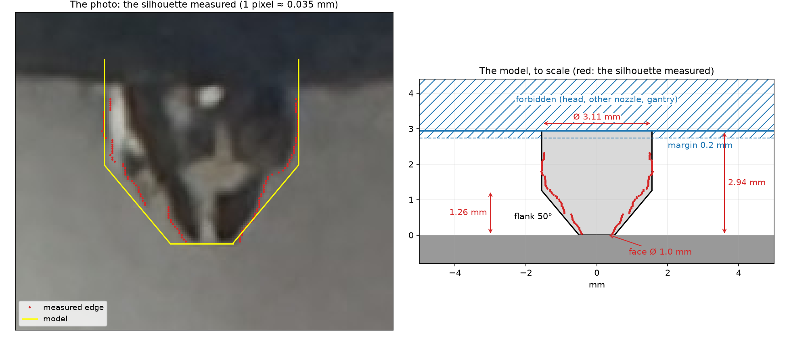

# Bambu Lab X2D

What layercraft knows of the X2D beyond its machine description, which `layercraft machine
import` reads from Bambu Studio's profiles. `printer.json` holds the values the compiler takes;
this page says where they come from.

## The toolhead

- The nozzle reaches **2.94 mm** below the underside of the rest of the head, and its column is
  **3.11 mm** across: measured by the owner with a caliper on 2026-10-29
  ([his sketch](toolhead-sketch.png)).
- Nothing may stand above that plane, however far from the nozzle. The head, the other nozzle,
  which is lifted, and the gantry are taken as one plane, with **0.2 mm** kept under it for beads
  that curl up and a plate not quite flat. The margin is the owner's choice.
- The nozzle's end was measured on [his photo](toolhead-photo.jpg) by
  [`measure_nozzle.py`](measure_nozzle.py), on the [crop](nozzle-photo.png) around the nozzle.
  The scale comes from the column. The end is a flat face about 0.88 mm across, whose flank
  rises about 53° to the column some 1.6 mm up. layercraft takes a face of **1.0 mm** and a
  flank of **50°**, which hold the silhouette within a pixel, 0.035 mm
  ([`nozzle-silhouette.csv`](nozzle-silhouette.csv)). The photo shows only 2.32 mm of the
  column; the rest hides behind the head's front edge.
- The profile's `nozzle_height` of 4.0 mm overstates the nozzle's reach. layercraft uses the
  measurement instead.

What follows from these numbers:
- A bent layer dips at most 2.74 mm below what is printed.
- The flank clears any slope under 50°.
- On a slope of angle θ, the face's uphill edge stands `0.5 · tan θ` above the tip: 0.18 mm at 20°.

## Motion

- The Z axis moves at most 20 mm/s (machine description). A bead climbing a 20° slope runs at
  most 58 mm/s.
- A spiral lift turns a helix of **1.2 mm**: the smallest radius that broke the string at the end
  of a print. The test used Bambu PLA Basic, one 10 mm cube per radius: at 0 the nozzle pulled up
  a 3 mm string, at 0.6 mm a 10 mm one, at 1.2 and 2.4 mm none. A larger turn only costs time.

## The firmware

- Before the first layer, the printer expects the filament's virtual tool to be named and its
  spaghetti detector turned on (`prologue`).
- It refuses a `.gcode.3mf` with error 0500-4046 when the plate summary does not describe the
  extruders, the nozzle, the filament order and the client version.

## Cooling and calibration

- Bambu PLA Basic's profile turns layer cooling off on the X2D
  (`slow_down_for_layer_cooling = 0`). The Benchy's cabin, laid at 0.7 to 3 s a layer, and its
  chimney, at 0.1 to 0.3 s, came out smeared. layercraft gives every layer its time to cool.
- The caliper calibration plates printed on this X2D are in [`calibration/`](../../calibration/).
  Plates leaning at 45° and 30° rise 0.12 to 0.22 mm above their design; the nozzle pushes with
  about 1.5 N at most.
