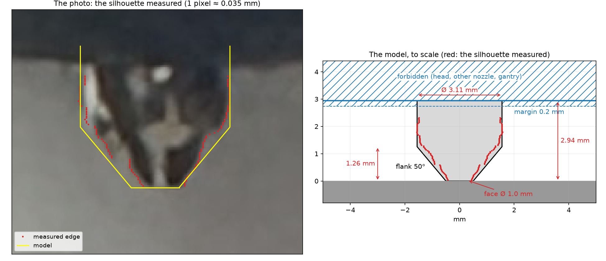

# Bambu Lab X2D

What layercraft knows of the X2D: its settings, each quality's and each material's, and its
measurements, hard-coded with every other default in
[`apps/layercraft/src/defaults.rs`](../../apps/layercraft/src/defaults.rs); and here its own
G-code, `start.gcode`, `layer-change.gcode`, `filament-change.gcode` and `end.gcode`, and how its
nozzle was measured. This page says where they come from.

## Settings

- They began, on 2026-11-18, as the values of Bambu Studio 02.08.02.61's profiles
  `Bambu Lab X2D 0.4 nozzle`, `0.20mm Standard @BBL X2D`, `0.12mm High Quality @BBL X2D`,
  `Bambu PLA Basic @BBL X2D 0.4 nozzle` and `Bambu PETG Translucent @BBL X2D 0.4 nozzle`, for
  the left, direct-drive nozzle (`Direct Drive Standard`), read as data, as they print: a
  percentage turned into its length or acceleration, a default into its value. They are the
  owner's since: the file's history is theirs. Since 0.22.0 no slicer is read at all.
- A new quality or material is an entry in `defaults.rs`, written out whole or as another's
  with what differs (`FINE` is `STANDARD` with finer layers).

## The start

`start.gcode` is layercraft's own, written from what the maker's gave on compiles that varied one
setting at a time (the plate and its temperature, the part's height, the filament's
temperatures, flow and type), in the maker's order; a test holds it to those measurements. It
plays a short tune, resets the machine and lights the logo lamp (both kept by the owner's
choice), cools the chamber, homes the head and checks the plate: foreign objects, presence,
alignment, flatness, a clean camera, and for a part 145 mm or taller that nothing is under the
plate. It loads the first filament from the AMS, calibrates its flow, wipes the nozzle, finds Z,
levels the plate where the first layer lies, measures the vibrations, calibrates the nozzles'
offset and lays a purge line; the flow, levelling and offset calibrations run as the print
command asks. The Z trim is 0.002 mm on the textured plate and 0.022 mm on the others, -0.003
and 0.017 above 70 °C. TPU and PVA are not pulled back after the calibration, PC cools to 170 °C
rather than 140 before touching the plate, TPU turns the clog detector on, and only PLA, PETG
and their carbon-fibre blends have the extruder watch for printing in the air. Printed on
2026-11-18 in PLA: the printer reported each stage in order (foreign objects, the plate's
checks, loading, flow calibration, wiping, levelling, vibrations, the nozzles' offset, the purge
line), then the first layer, no error.

## The layer change

`layer-change.gcode` is layercraft's own, written from what the maker's gave on compiles that
varied one setting at a time; a test holds it to those measurements. Before each layer it counts
the layer for the printer (`M73 L`, `M991`). Through a filament's first
`close_additional_fan_first_x_layers` layers it holds the two auxiliary part fans at
`first_x_layer_fan_speed`, then, when `additional_fan_full_speed_layer` is later, climbs in a
straight line to `additional_cooling_fan_speed` there; then it hands them to the printer's own
chamber cooling (`M142`), which keeps them at that speed or faster as the chamber warms. Its
band is one for filaments that soften at 50 °C or less (PLA, TPU), another above (PETG), as
measured with the 0.4 mm nozzle. Printed on 2026-11-18 in PLA, the printer reported its two
auxiliary fans at 40 % through layer 1 and at 70 % from layer 2, its layer counter following,
no error.

## The filament change

`filament-change.gcode` is layercraft's own, written from what the maker's gave on compiles of
two-colour plates that varied one setting at a time; a test holds it to those measurements. It
lifts the head 3 mm, sets how the old and the new filament are flushed (the flush speed, the
temperatures, and no length: nothing is thrown away, what wets the nozzle mixing into the new
filament's first inner walls, as the owner prefers), pulls the old filament back out of the nozzle
by the filament's own distance, 10 mm, and cuts it (the long retraction,
`long_retractions_when_cut`), pulls it back 3 mm more as
it leaves the extruder, loads the new one,
calibrates its flow, watches for printing in the air as the start does, and sets its auxiliary
fans as the layer change would, the printer's chamber cooling past its first layers. The
maker's change also has a spiral lift for later changes, which layercraft never ran: its
condition compared the lift type's name with numbers. It is left out; the head rises straight.
A filament has no G-code of its own: the printer's sequences read its settings.

## The end

`end.gcode` is layercraft's own, written in the template language for the X2D's firmware, whose
Bambu-specific commands are undocumented: their roles come from where the printer's own files
use them and from what its owners report. It lifts the nozzle 0.4 mm then 10 mm, turns the
heaters and fans off, sends each nozzle's filament back into the AMS, parks the head and lowers
the plate, with Z at 40 % of its current, to 80 mm or 10 mm under the top of a taller part. It
resets the speed, acceleration and time scales and the detectors, purifies the air for three
minutes when the printer is set to, and plays a rising C major arpeggio. It leaves out the
maker's timelapse. Printed on 2026-11-18: the filament went back into the AMS (`tray_now` 255,
both extruders empty), the head parked, the plate came down, no error.

## The toolhead

- The nozzle reaches **2.94 mm** below the underside of the rest of the head, and its column is
  **3.11 mm** across: measured by the owner with a caliper on 2026-10-29
  ([his sketch](toolhead-sketch.png)).
- Nothing may stand above that plane, however far from the nozzle. The head, the other nozzle,
  which is lifted, and the gantry are taken as one plane, with **0.2 mm** kept under it for beads
  that curl up and a plate not quite flat. The margin is the owner's choice.
- The nozzle's end was measured on [his photo](toolhead-photo.jpg) by
  [`measure_nozzle.py`](measure_nozzle.py), on the [crop](nozzle-photo.png) around the nozzle.
  The scale comes from the column. The end is a flat face about 0.88 mm across, whose flank
  rises about 53° to the column some 1.6 mm up. layercraft takes a face of **1.0 mm** and a
  flank of **50°**, which hold the silhouette within a pixel, 0.035 mm
  ([`nozzle-silhouette.csv`](nozzle-silhouette.csv)). The photo shows only 2.32 mm of the
  column; the rest hides behind the head's front edge.
- The profile's `nozzle_height` of 4.0 mm overstates the nozzle's reach. layercraft uses the
  measurement instead.

What follows from these numbers:
- A bent layer dips at most 2.74 mm below what is printed.
- The flank clears any slope under 50°.
- On a slope of angle θ, the face's uphill edge stands `0.5 · tan θ` above the tip: 0.18 mm at 20°.

## Motion

- The Z axis moves at most 20 mm/s (`machine_max_speed_z`). A bead climbing a 20° slope runs at
  most 58 mm/s.
- A spiral lift turns a helix of **1.2 mm**: the smallest radius that broke the string at the end
  of a print. The test used Bambu PLA Basic, one 10 mm cube per radius: at 0 the nozzle pulled up
  a 3 mm string, at 0.6 mm a 10 mm one, at 1.2 and 2.4 mm none. A larger turn only costs time.

## The firmware

- Before the first layer, the printer expects the filament's virtual tool to be named and its
  spaghetti detector turned on (`prologue`).
- It refuses a `.gcode.3mf` with error 0500-4046 when the plate summary does not describe the
  extruders, the nozzle, the filament order and the client version.

## Cooling and calibration

- Bambu PLA Basic's profile turns layer cooling off on the X2D
  (`slow_down_for_layer_cooling = 0`). The Benchy's cabin, laid at 0.7 to 3 s a layer, and its
  chimney, at 0.1 to 0.3 s, came out smeared. layercraft gives every layer its time to cool.
- The caliper calibration plates printed on this X2D are in [`calibration/`](../../calibration/).
  Plates leaning at 45° and 30° rise 0.12 to 0.22 mm above their design; the nozzle pushes with
  about 1.5 N at most.
